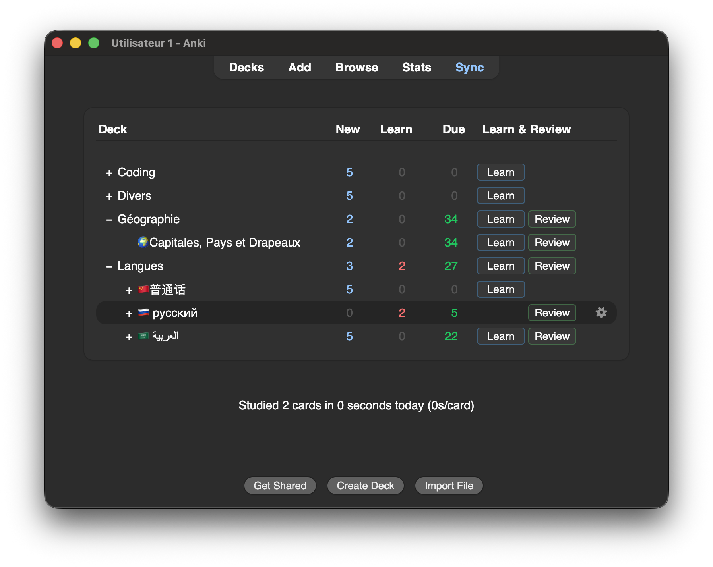

# Learn & Review

An Anki add-on that adds separate **Learn** and **Review** actions to the Deck Browser — now with **per-deck alternative card presentations**.

> [!WARNING]
> **Experimental software — back up your Anki collection before using this add-on.**
>
> This add-on is still experimental and may contain bugs. Before installing or updating it, **create a backup of your collection, including media**, and make sure you can restore it. Testing with a separate Anki profile is recommended.
>
> **Use at your own risk.** The author is not responsible for lost progress, data loss, or collection corruption resulting from use of this add-on. This notice does not limit any rights that cannot legally be excluded.

## Why?

By default, Anki provides a single **Study** action for a deck. That session can include both new cards and review cards depending on what is available.

This add-on separates these two workflows:

- **Learn** — starts a session dedicated to new cards available for learning. Each new card is introduced once through the learning process.
- **Review** — starts a session for cards already in the learning/relearning/review cycle.

This makes it possible to explicitly choose what you want to work on instead of letting the standard Study session mix both.



## Alternative card presentations

**Learn and Review can now show different fronts and backs of the same card, without creating duplicate Anki cards.** For example, you can recognize an Arabic word when learning it (**Arabic → English**), then practice recalling it from English during review (**English → Arabic**), while keeping a single scheduling history.

You can configure this independently for each deck:

1. Open the **gear menu** next to a deck in Anki's Deck Browser.
2. Select **Learn & Review**.
3. Choose **Original (Anki)** or **Alternative** separately for **Learn** and **Review**.
4. To create an alternative presentation, copy the existing Anki card template into the editor, then customize its **front HTML**, **back HTML**, and optional **additional CSS**.
5. Save the settings for that deck.

The alternative uses Anki's template rendering, including fields and conditional sections. It inherits the note type's existing styling; additional CSS is optional.

**Nothing changes until you select an alternative presentation.** Both modes use the original Anki presentation by default. These settings are stored by the add-on, rather than modifying your note types or deck presets.

> [!NOTE]
> Alternative presentations change how an existing card is **displayed**, not its Anki card type, scheduling state, or review history. You do **not** need to create a second card type (which would generate additional cards).

## Installation

The add-on is not yet published on AnkiWeb. For now, it can be installed manually from the releases available on the [Releases page](../../releases).

1. Download the latest release.
2. Extract the archive.
3. Copy the add-on folder into Anki's `addons21` directory.
4. Restart Anki.

The `addons21` directory is located at:

- **Windows:** `%APPDATA%\Anki2\addons21`
- **macOS:** `~/Library/Application Support/Anki2/addons21`
- **Linux:** `~/.local/share/Anki2/addons21`

### How to build

To package the add-on into a distributable `.zip` file, run the build script from the repository root:

```bash
python3 build.py
```

The resulting zip file will be generated in the `dist/` directory. The builder checks that all required add-on modules and its `config.json` are present before packaging.

## Technical approach

The add-on does not implement its own scheduler.

It uses Anki's native **V3 scheduler** and its existing scheduling rules, card states, and daily limits. Alternative presentations are rendered in memory using Anki's template rendering system; they do not create additional cards or alter scheduling.

It does **not**:

- increase or bypass daily card limits, unlike some existing add-ons that modify or work around these limits;
- modify Anki's native deck options or note types;
- change Anki's scheduling algorithm;
- alter card states to make additional cards available.

The add-on provides separate entry points into Anki's existing scheduling system and optional presentation customization while keeping native scheduling behavior intact.

## Support

This add-on is completely free and open-source. If you find it valuable, you can support its development with a pay-what-you-want contribution!

[](https://ko-fi.com/yougo)

## License

This project is licensed under the **GNU Affero General Public License v3.0 (AGPLv3)**.

See [`LICENSE`](LICENSE) for the full license text.
